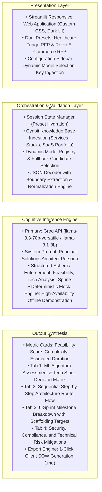

# Technical Approach Report: Architecture, Pipeline, and Execution Plan for Cynbit ScopeAI
**Target Organization:** Cynbit Technologies (`cynbit.in`)  
**Applicant:** Nimendra Giri  
**Role:** AI/ML Engineer Intern Assessment  
**Date:** October 2026  
**Repository:** [nimendragiri-lgtm/Cynbit_technologies_assessment](https://github.com/nimendragiri-lgtm/Cynbit_technologies_assessment)  
**Live Prototype:** [Streamlit Application](https://nimendragiri-lgtm-cynbit-technologies-assessment-app-91puum.streamlit.app/)  

---

## 1. System Architecture & Component Design
Cynbit ScopeAI is designed as an asynchronous, modular microservice architecture using Streamlit as the interactive presentation layer and Groq Cloud / Llama 3 models as the cognitive reasoning engine.



---

## 2. Model Selection Rationale

| Engine Candidate | Evaluation Criteria | Production Decision |
| :--- | :--- | :--- |
| **Llama-3.3-70b-versatile** | High contextual reasoning, adherence to complex nested JSON schemas, low hallucination rate on architectural tradeoffs. | **Primary Production Model** (Selected for production queries requiring deep tech stack comparisons). |
| **Llama-3.1-8b-instant** | Ultra-low latency (<1.2s inference time), minimal token consumption, cost-efficient for preliminary classification. | **High-Throughput Candidate** (Used for preliminary scoping and rapid turnaround). |
| **Deterministic Mock Engine** | 100% availability, zero external API key requirements, resilient baseline for offline demonstrations and reviewer evaluations. | **Built-in Resiliency Layer** (Active fallback upon rate limits or authentication failures). |

---

## 3. Data Pipeline & Schema Validation

### 3.1 Prompt Orchestration
The prompt establishes the persona of Cynbit's Chief Solutions Architect, injecting Cynbit's service capabilities directly into context:
* **System Prompt:** Instructs the model to output purely valid, parseable JSON without conversational preambles or markdown backticks.
* **Input Injection:** Ingests Project Title, Problem Statement, Target Platforms, and Compliance Standards (HIPAA, SOC2, GDPR, AWS Zero-Trust).

### 3.2 Robust Ingestion & Parser Sanitation
LLMs can occasionally wrap JSON in markdown tags or prepend conversational text. ScopeAI eliminates parsing failures via a fault-tolerant extraction sequence:
1. Regex stripping of ```` ```json ```` and trailing ```` ``` ```` tags.
2. Index-based boundary detection locating the initial `{`.
3. `json.JSONDecoder().raw_decode` parsing that parses valid JSON while ignoring trailing commentary.
4. Normalization of the `tech_stack_analysis` array to ensure dictionaries and strings parse safely into the UI.

---

## 4. Deep Tech Stack Decision Matrix

The prototype dynamically evaluates why technologies are chosen over industry alternatives:

* **FastAPI (Backend Gateway):** Selected for native Python asynchronous support (`asyncio`), enabling non-blocking execution across streaming endpoints and LLM integrations. *Alternatives evaluated:* Django Ninja, Express.js, Flask.
* **Next.js 14 + TailwindCSS (Frontend):** Selected for Server-Side Rendering (SSR) and strict component isolation, providing fast initial workstation load times for dashboards. *Alternatives evaluated:* React SPA, Vue/Nuxt, Angular.
* **Pinecone + pgvector (Vector Storage):** Provides sub-millisecond semantic retrieval across dense vector indices with minimal cluster management overhead. *Alternatives evaluated:* Qdrant, Milvus, Weaviate.
* **AWS ECS Fargate (Container Orchestration):** Serverless Docker containerization eliminating manual EC2 patching while supporting auto-scaling during traffic spikes. *Alternatives evaluated:* GCP Cloud Run, Kubernetes (EKS), Azure App Services.

---

## 5. Execution Roadmap

```text
Phase 1: Proof of Concept (Completed)
├── Streamlit application deployment with interactive RFP synthesis
├── Fault-tolerant JSON parser and Groq API orchestration
├── Integrated Statement of Work (SOW) markdown export engine
└── Dual client scenario presets (Healthcare Triage & Revio E-Commerce)

Phase 2: RAG Vector Store & Case Study Ingestion (Months 1-2)
├── Ingestion of Cynbit’s historical repository architectures and past delivery metrics
├── Vectorization of Cynbit case studies into Pinecone for automated similarity matching
└── Calibration of sprint estimations against verified historical engineering story points

Phase 3: Production CRM & Workflow Integration (Months 3-4)
├── FastAPI REST microservice wrapper exposing /api/v1/scope endpoints
├── Bidirectional webhook sync to HubSpot / Cynbit CRM and Slack channels
└── Automated generation of signed PDF proposals for qualified enterprise prospects
```